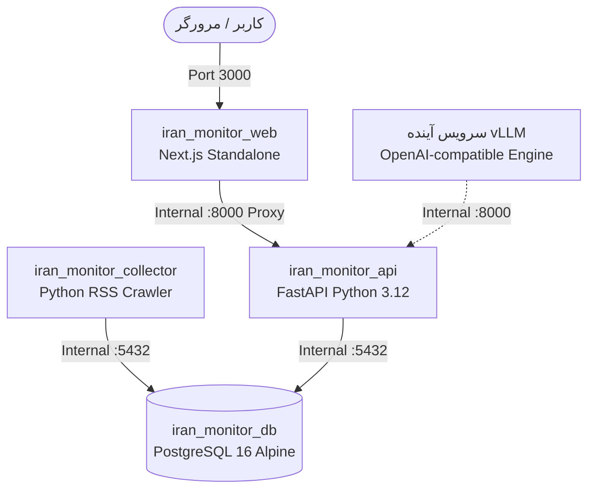

# Iran Monitor — System Architecture

سامانه هوشمند پایش و رصد دفاعی و امنیتی ایران (Iran Monitor) یک بستر جامع برای جمع‌آوری، پردازش، تحلیل و نمایش اخبار و داده‌های متنی منابع باز (OSINT) است.

## ۱. نمای کلی سیستم و کانتینرها (Container Topology)

کل سیستم در قالب یک فایل `docker-compose.yml` چند سرویسی و متصل به شبکه ایزوله `iran_monitor_net` اجرا می‌شود:

| نام سرویس | نام کانتینر | پورت میزبان (Host) | پورت داخلی (Container) | وظیفه اصلی |
| :--- | :--- | :--- | :--- | :--- |
| **frontend** | `iran_monitor_web` | `3000` | `3000` | رابط کاربری پیشرفته Next.js 16، احراز هویت، داشبورد رصد و صفحات جزئیات اخبار |
| **backend** | `iran_monitor_api` | `8000` | `8000` | وب‌سرویس REST API با فریم‌ورک FastAPI، احراز هویت دیتابیسی، مدیریت متادیتا و دسته‌بندی |
| **collector** | `iran_monitor_collector` | — | — | پردازشگر زمان‌بندی‌شده دوره‌ای (هر ۱۵ دقیقه) برای خزش فیدهای RSS و ثبت اخبار جدید |
| **postgres** | `iran_monitor_db` | `5433` | `5432` | پایگاه‌داده رابطه‌ای، ماندگاری داده در Named Volume با بیش از ۸,۰۰۰ خبر |

---

## ۲. مشخصات و مسئولیت سرویس‌ها

### ۲.۱. فرانت‌اند (`apps/web-next`)
- توسعه‌یافته بر پایه **Next.js 16 (App Router)** و **React 19**.
- ساختار Multi-stage build بر پایه `node:24-bookworm-slim` با خروجی بهینه `standalone` (حجم نهایی زیر ۲۰۰ مگابایت).
- قابلیت Runtime Proxy در روت `/api/v1/[...path]` برای فوروارد امن درخواست‌ها به بک‌اند بدون نیاز به افشای آدرس داخلی شبکه.
- صفحه ورود شکیل سه‌بعدی و ماژستیک با افکت کره زمین مه‌آلود چرخان و تم سرمه‌ای/کرم سازمانی.
- رابط RTL کامل با فونت وزیرمتن (Vazirmatn).

### ۲.۲. بک‌اند (`apps/api`)
- توسعه‌یافته با **Python 3.12** و **FastAPI**.
- معماری ایمن بدون دسترسی ریشه (Non-root user `appuser`).
- ماژول احراز هویت `auth.py`: بررسی کلمه عبور با استاندارد **PBKDF2-HMAC-SHA256 با ۱۰۰,۰۰۰ دور محاسباتی** و نمک تصادفی ۱۶ بایتی اختصاصی برای هر کاربر.
- ماژول‌های دسته‌بندی موضوعی هوشمند و تحلیل نهادها (`classify_v2.py` و `clustering.py`).

### ۲.۳. جمع‌آوری‌کننده خبر (`collector.py`)
- زمان‌بندی خودکار هر ۱۵ دقیقه (`NEWS_COLLECTION_INTERVAL_SECONDS=900`).
- پایبندی به سیاست عدم مسدودسازی: «۱ درخواست به ازای هر منبع در هر چرخه».
- کنترل تکراری بودن با محاسبه هش و درج تراکنشی اتمیک در جدول `news_items`.

### ۲.۴. برنامه آینده ترجمه با vLLM
- به جای ورکرها و وابستگی‌های آزمایشی قدیمی، سرویس ترجمه هوشمند مستقیماً از طریق یک کانتینر اختصاصی **vLLM** در داکر با رابط استاندارد سازگار با OpenAI (`/v1/chat/completions`) متصل خواهد شد تا به صورت موازی، سریع و پایدار متون اخبار و خلاصه را ترجمه کند.
